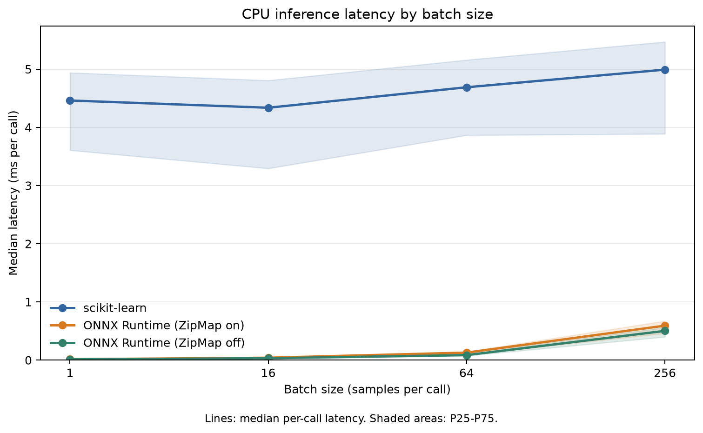
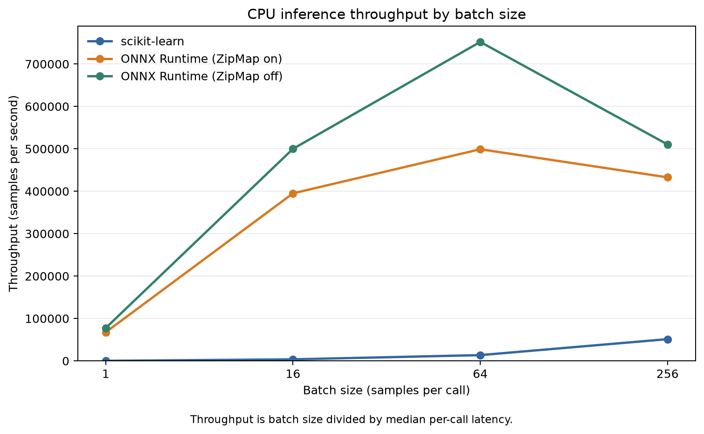
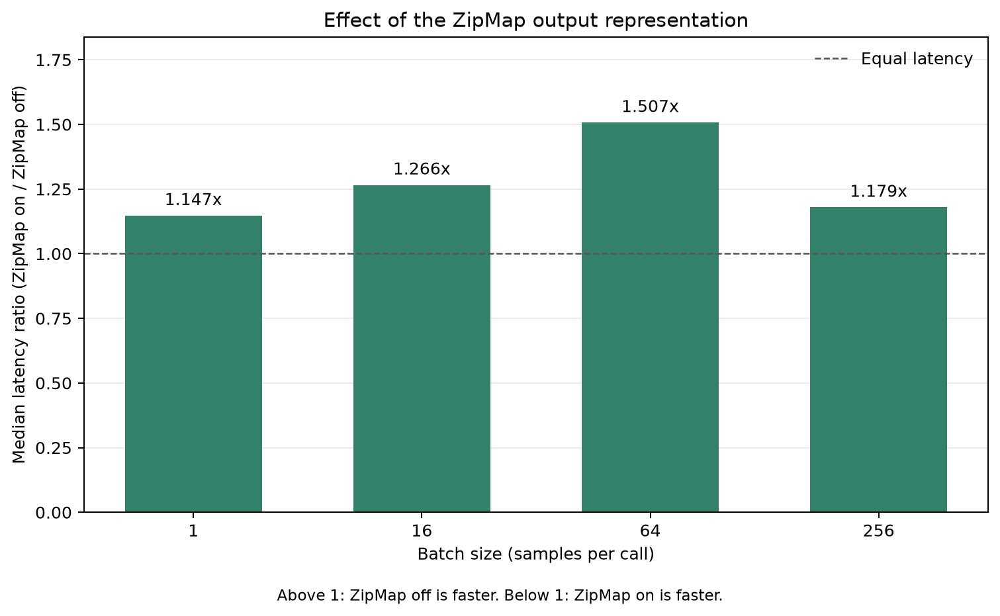

# CPU inference benchmark results

This run compares the same trained 100-tree Random Forest on the Breast Cancer Wisconsin dataset using scikit-learn and two ONNX Runtime output representations. All measurements come from this run on one CPU machine. Hardware and software versions are recorded in [environment.json](environment.json); the data split is recorded in [dataset.json](dataset.json), model parameters in [model_parameters.json](model_parameters.json), effective runtime and thread settings in [runtime_settings.json](runtime_settings.json), and experiment and timing settings in [config.json](config.json).

## All measured configurations

| Backend | Batch size | Timed calls | Median (ms) | P25-P75 (ms) | P95 (ms) | Throughput (samples/s) | Speedup vs scikit-learn |
| --- | ---: | ---: | ---: | ---: | ---: | ---: | ---: |
| scikit-learn | 1 | 1000 | 4.46075 | 3.60643-4.93905 | 7.64719 | 224.178 | 1.0000x |
| scikit-learn | 16 | 1000 | 4.33625 | 3.29315-4.80588 | 7.44605 | 3689.82 | 1.0000x |
| scikit-learn | 64 | 1000 | 4.6879 | 3.86457-5.15827 | 7.4854 | 13652.2 | 1.0000x |
| scikit-learn | 256 | 1000 | 4.9908 | 3.88707-5.4695 | 7.12883 | 51294.4 | 1.0000x |
| ONNX Runtime (ZipMap on) | 1 | 1000 | 0.0148 | 0.0146-0.016 | 0.0178 | 67567.6 | 301.4020x |
| ONNX Runtime (ZipMap on) | 16 | 1000 | 0.0405 | 0.0278-0.042325 | 0.046 | 395062 | 107.0679x |
| ONNX Runtime (ZipMap on) | 64 | 1000 | 0.12825 | 0.0906-0.1442 | 0.21555 | 499025 | 36.5528x |
| ONNX Runtime (ZipMap on) | 256 | 1000 | 0.5915 | 0.460375-0.672275 | 1.09306 | 432798 | 8.4375x |
| ONNX Runtime (ZipMap off) | 1 | 1000 | 0.0129 | 0.0128-0.014025 | 0.015105 | 77519.4 | 345.7946x |
| ONNX Runtime (ZipMap off) | 16 | 1000 | 0.032 | 0.0236-0.0383 | 0.048755 | 500000 | 135.5078x |
| ONNX Runtime (ZipMap off) | 64 | 1000 | 0.0851 | 0.073375-0.111 | 0.134445 | 752056 | 55.0870x |
| ONNX Runtime (ZipMap off) | 256 | 1000 | 0.5016 | 0.3982-0.56085 | 0.654495 | 510367 | 9.9498x |

The median is the middle observed per-call timing. P25-P75 shows the central 50% of timings (the interquartile range); P95 is the 95th percentile. These describe timing variation and are not confidence intervals for a population of machines. Throughput is batch size divided by median call time. Speedup is the scikit-learn median divided by the compared backend median for the same batch size: above 1 means faster and below 1 means slower.

## ZipMap comparison

| Batch size | Median latency: ZipMap on / ZipMap off |
| ---: | ---: |
| 1 | 1.1473x |
| 16 | 1.2656x |
| 64 | 1.5071x |
| 256 | 1.1792x |

A ratio above 1 favors disabling ZipMap; below 1 favors enabling it. This is a measured change between converted graphs and their output representations, not an isolated measurement of one operator's cost.

## Prediction correctness

Overall check passed: **yes**. Original held-out cases: **114**. Absolute probability tolerance: **1e-05**.

Baseline scikit-learn accuracy: **95.6140%**.

| Backend | Label agreement | Accuracy | Maximum absolute probability error | Finite probabilities | Normalized probability rows |
| --- | ---: | ---: | ---: | --- | --- |
| scikit-learn | 100.0000% | 95.6140% | 0 | yes | yes |
| ONNX Runtime (ZipMap on) | 100.0000% | 95.6140% | 6.55651e-07 | yes | yes |
| ONNX Runtime (ZipMap off) | 100.0000% | 95.6140% | 6.55651e-07 | yes | yes |

## Measurement scope and limitations

- Accuracy and agreement use the original held-out cases. Repeated inputs used to form synthetic performance batches are not additional independent accuracy samples.
- Timings cover warmed, in-process inference calls and the output objects materialized by those APIs. Model loading, session creation, input preparation, output object destruction, and dictionary-to-matrix conversion for correctness checks are outside the timed region.
- scikit-learn is measured through predict_proba; ONNX Runtime fetches the probability output only. ZipMap on returns dictionaries and ZipMap off returns a tensor. This compares probability-producing APIs rather than isolated model computation; scikit-learn's Python tree dispatch is included. Consumers needing a different final format may incur additional conversion costs.
- OS power settings and thread placement are not controlled by this benchmark. Record the machine's power mode, concurrent workload, and other relevant run conditions manually when interpreting or repeating these measurements.
- One machine, one dataset, and one Random Forest configuration cannot establish performance for other models, hardware, GPU execution, or production workloads. Repeated fixed inputs and warmed sessions also differ from cold requests and changing inputs.
- Conclusions should follow the observed ratios and timing spread. A slower ONNX result is still a valid observation; no acceleration factor was assumed in advance.

Raw per-call observations are retained in [timings.csv](timings.csv); the table above is generated from [summary.csv](summary.csv). Prediction checks are recorded in [correctness.json](correctness.json).

Setup durations are recorded separately in [setup_times.json](setup_times.json) and are excluded from the steady-state inference ratios above.
