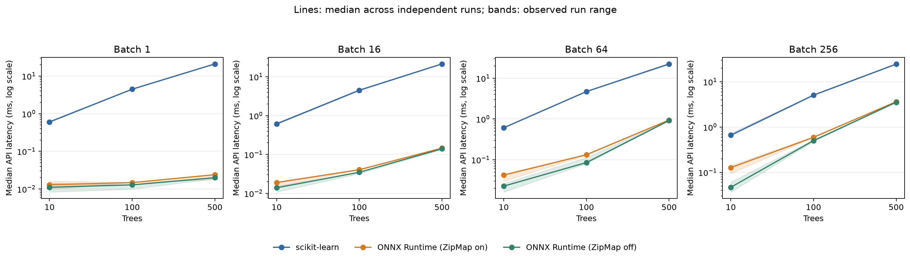
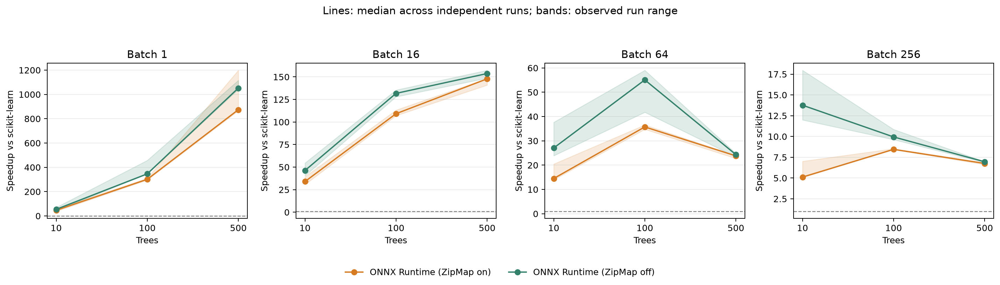
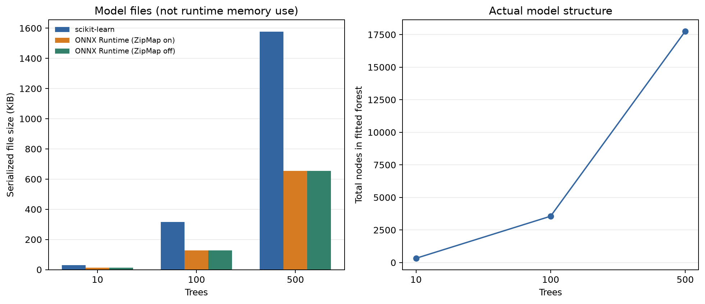
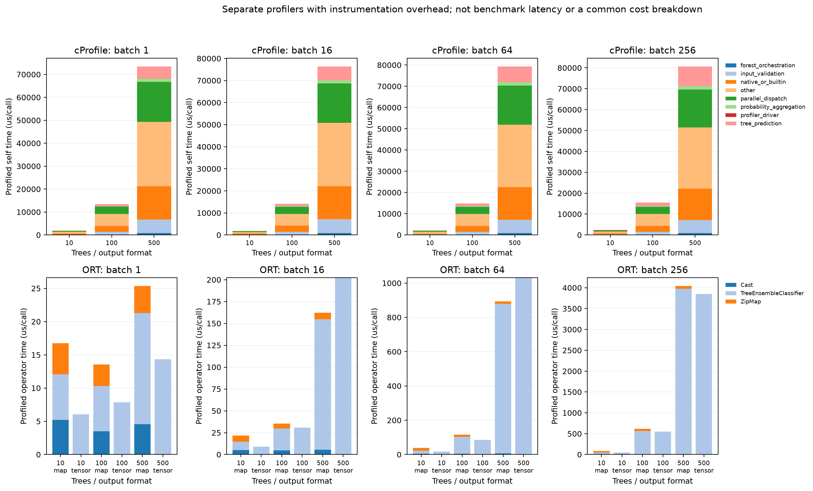

# 隨機森林樹數與 ONNX 推理效能研究

本次比較 10、100、500 棵樹，每種模型獨立執行 3 次，共 9 個子實驗、108,000 次正式計時。資料為 Breast Cancer Wisconsin，固定分層 80/20 切分、seed 42、float32、CPU 單執行緒。每個森林分別比較 scikit-learn 與由同一森林轉換的兩版 ONNX。

每配置先暖機 50 次，再執行 10 輪 × 100 次。樹數順序逐次輪換；所有正式計時完成後才執行 profiling 與繪圖。

## 實測延遲及加速比

表中延遲、P95、吞吐量及加速比均先按各次實驗計算，再取跨次中位數。加速比的範圍是各次觀察到的最小／最大值，不是信賴區間。加速比大於 1 表示 ONNX 較快，小於 1 表示較慢。

| 樹數 | Batch | 執行方式 | 延遲 ms | 跨次延遲範圍 ms | P95 ms | 吞吐量 samples/s | 加速比 | 跨次加速比範圍 |
| ---: | ---: | --- | ---: | ---: | ---: | ---: | ---: | ---: |
| 10 | 1 | scikit-learn | 0.605 | 0.581–0.6134 | 0.93984 | 1652.89 | 1.000× | 1.000–1.000× |
| 10 | 1 | ONNX Runtime (ZipMap on) | 0.013 | 0.0098–0.0161 | 0.0152 | 76923.1 | 46.538× | 38.099–59.286× |
| 10 | 1 | ONNX Runtime (ZipMap off) | 0.0111 | 0.0083–0.0143 | 0.013305 | 90090.1 | 54.505× | 42.895–70.000× |
| 10 | 16 | scikit-learn | 0.6142 | 0.58905–0.64225 | 0.994945 | 26050.1 | 1.000× | 1.000–1.000× |
| 10 | 16 | ONNX Runtime (ZipMap on) | 0.0189 | 0.015–0.02 | 0.0282 | 846561 | 33.981× | 30.710–39.270× |
| 10 | 16 | ONNX Runtime (ZipMap off) | 0.0139 | 0.0108–0.0152 | 0.021 | 1.15108e+06 | 46.205× | 40.408–54.542× |
| 10 | 64 | scikit-learn | 0.60905 | 0.6062–0.6187 | 0.904935 | 105082 | 1.000× | 1.000–1.000× |
| 10 | 64 | ONNX Runtime (ZipMap on) | 0.042 | 0.0296–0.0442 | 0.05342 | 1.52381e+06 | 14.501× | 13.998–20.480× |
| 10 | 64 | ONNX Runtime (ZipMap off) | 0.0225 | 0.0161–0.0259 | 0.02835 | 2.84444e+06 | 27.069× | 23.888–37.652× |
| 10 | 256 | scikit-learn | 0.66125 | 0.64555–0.73 | 1.03002 | 387146 | 1.000× | 1.000–1.000× |
| 10 | 256 | ONNX Runtime (ZipMap on) | 0.1274 | 0.0942–0.14265 | 0.15932 | 2.00942e+06 | 5.117× | 5.067–7.020× |
| 10 | 256 | ONNX Runtime (ZipMap off) | 0.0469 | 0.0368–0.06085 | 0.07679 | 5.45842e+06 | 13.764× | 11.997–17.969× |
| 100 | 1 | scikit-learn | 4.46815 | 4.46075–4.53 | 7.55619 | 223.806 | 1.000× | 1.000–1.000× |
| 100 | 1 | ONNX Runtime (ZipMap on) | 0.0148 | 0.0146–0.0151 | 0.0199 | 67567.6 | 301.402× | 295.904–310.274× |
| 100 | 1 | ONNX Runtime (ZipMap off) | 0.0129 | 0.0099–0.0129 | 0.020705 | 77519.4 | 346.368× | 345.795–457.576× |
| 100 | 16 | scikit-learn | 4.5052 | 4.33625–4.59775 | 6.78021 | 3551.45 | 1.000× | 1.000–1.000× |
| 100 | 16 | ONNX Runtime (ZipMap on) | 0.0406 | 0.0405–0.04125 | 0.0489 | 394089 | 109.217× | 107.068–113.245× |
| 100 | 16 | ONNX Runtime (ZipMap off) | 0.0349 | 0.032–0.0352 | 0.048755 | 458453 | 131.741× | 127.989–135.508× |
| 100 | 64 | scikit-learn | 4.7093 | 4.6879–4.7419 | 6.57597 | 13590.1 | 1.000× | 1.000–1.000× |
| 100 | 64 | ONNX Runtime (ZipMap on) | 0.1327 | 0.12825–0.13545 | 0.263905 | 482291 | 35.734× | 34.768–36.553× |
| 100 | 64 | ONNX Runtime (ZipMap off) | 0.0851 | 0.0803–0.1127 | 0.16355 | 752056 | 55.087× | 41.786–59.052× |
| 100 | 256 | scikit-learn | 5.0602 | 4.9908–5.2026 | 7.5787 | 50590.9 | 1.000× | 1.000–1.000× |
| 100 | 256 | ONNX Runtime (ZipMap on) | 0.59315 | 0.5915–0.61545 | 1.03719 | 431594 | 8.453× | 8.438–8.531× |
| 100 | 256 | ONNX Runtime (ZipMap off) | 0.5016 | 0.4792–0.52535 | 0.654495 | 510367 | 9.950× | 9.632–10.857× |
| 500 | 1 | scikit-learn | 20.9809 | 20.9566–21.0393 | 30.077 | 47.6623 | 1.000× | 1.000–1.000× |
| 500 | 1 | ONNX Runtime (ZipMap on) | 0.024 | 0.01755–0.0242 | 0.0297 | 41666.7 | 874.206× | 865.973–1198.823× |
| 500 | 1 | ONNX Runtime (ZipMap off) | 0.02 | 0.0188–0.0201 | 0.025105 | 50000 | 1051.967× | 1042.614–1116.008× |
| 500 | 16 | scikit-learn | 21.4327 | 21.386–21.4904 | 30.1564 | 746.521 | 1.000× | 1.000–1.000× |
| 500 | 16 | ONNX Runtime (ZipMap on) | 0.14535 | 0.14425–0.15205 | 0.27521 | 110079 | 147.853× | 140.959–148.256× |
| 500 | 16 | ONNX Runtime (ZipMap off) | 0.1398 | 0.1359–0.1442 | 0.22304 | 114449 | 153.722× | 148.632–157.366× |
| 500 | 64 | scikit-learn | 22.43 | 21.4604–22.5386 | 31.9167 | 2853.33 | 1.000× | 1.000–1.000× |
| 500 | 64 | ONNX Runtime (ZipMap on) | 0.9414 | 0.9405–0.94285 | 1.20075 | 67983.9 | 23.826× | 22.761–23.964× |
| 500 | 64 | ONNX Runtime (ZipMap off) | 0.9168 | 0.90645–0.92115 | 1.47132 | 69808 | 24.350× | 23.408–24.865× |
| 500 | 256 | scikit-learn | 24.5323 | 24.1499–24.8189 | 34.1829 | 10435.2 | 1.000× | 1.000–1.000× |
| 500 | 256 | ONNX Runtime (ZipMap on) | 3.62945 | 3.62925–3.6433 | 5.27197 | 70534.1 | 6.759× | 6.629–6.839× |
| 500 | 256 | ONNX Runtime (ZipMap off) | 3.522 | 3.5124–3.5644 | 4.86334 | 72686 | 6.963× | 6.876–6.965× |

## 模型大小是否影響加速效果

| 樹數 | 總節點數 | 最大深度 | sklearn 檔案 KiB | ONNX ZipMap KiB | ONNX tensor KiB |
| ---: | ---: | ---: | ---: | ---: | ---: |
| 10 | 326 | 10 | 30.634 | 12.398 | 12.252 |
| 100 | 3556 | 10 | 316.728 | 127.755 | 127.608 |
| 500 | 17754 | 11 | 1575.946 | 654.252 | 654.105 |

- Batch 1，ONNX Runtime (ZipMap on)：樹數由小到大時，加速比分別為 46.538×、301.402×、874.206×，跨次中位數呈現上升。
- Batch 1，ONNX Runtime (ZipMap off)：樹數由小到大時，加速比分別為 54.505×、346.368×、1051.967×，跨次中位數呈現上升。
- Batch 16，ONNX Runtime (ZipMap on)：樹數由小到大時，加速比分別為 33.981×、109.217×、147.853×，跨次中位數呈現上升。
- Batch 16，ONNX Runtime (ZipMap off)：樹數由小到大時，加速比分別為 46.205×、131.741×、153.722×，跨次中位數呈現上升。
- Batch 64，ONNX Runtime (ZipMap on)：樹數由小到大時，加速比分別為 14.501×、35.734×、23.826×，跨次中位數呈現沒有單調變化。
- Batch 64，ONNX Runtime (ZipMap off)：樹數由小到大時，加速比分別為 27.069×、55.087×、24.350×，跨次中位數呈現沒有單調變化。
- Batch 256，ONNX Runtime (ZipMap on)：樹數由小到大時，加速比分別為 5.117×、8.453×、6.759×，跨次中位數呈現沒有單調變化。
- Batch 256，ONNX Runtime (ZipMap off)：樹數由小到大時，加速比分別為 13.764×、9.950×、6.963×，跨次中位數呈現下降。

這是同一資料集、同一種森林在不同樹數下的觀察。樹數增加也改變總節點數及模型結構；序列化檔案大小不是 runtime 記憶體占用量，亦不能單獨證明快取或向量化機制。不同樹數的模型各自訓練；一致性驗證只要求同一森林在不同 runtime 間一致，不要求三個森林預測完全相同。

## 各步驟耗時與 ONNX 加速原因

正式延遲涵蓋 probability API 呼叫及返回物件建立，排除輸入準備、模型載入、session 建立、驗證、ZipMap 字典轉矩陣與返回物件銷毀。一次性準備成本另外列出：

| 樹數 | 步驟 | 執行方式 | 耗時中位數 ms | 跨次範圍 ms |
| ---: | --- | --- | ---: | ---: |
| 10 | conversion | ONNX Runtime (ZipMap off) | 12.6686 | 8.666–16.0886 |
| 10 | conversion | ONNX Runtime (ZipMap on) | 36.9326 | 23.3589–50.9796 |
| 10 | ort_session_creation | ONNX Runtime (ZipMap off) | 0.74 | 0.7082–0.9308 |
| 10 | ort_session_creation | ONNX Runtime (ZipMap on) | 1.3818 | 1.1543–4.1281 |
| 10 | sklearn_model_load | scikit-learn | 8.0179 | 5.3482–8.0312 |
| 10 | training | scikit-learn | 10.8227 | 8.4878–12.6195 |
| 100 | conversion | ONNX Runtime (ZipMap off) | 140.846 | 138.321–150.781 |
| 100 | conversion | ONNX Runtime (ZipMap on) | 163.038 | 161.18–184.301 |
| 100 | ort_session_creation | ONNX Runtime (ZipMap off) | 2.5834 | 2.0202–2.6179 |
| 100 | ort_session_creation | ONNX Runtime (ZipMap on) | 3.0971 | 2.4948–3.2401 |
| 100 | sklearn_model_load | scikit-learn | 17.5022 | 12.4649–25.4576 |
| 100 | training | scikit-learn | 141.425 | 141.225–143.487 |
| 500 | conversion | ONNX Runtime (ZipMap off) | 610.695 | 601.594–640.671 |
| 500 | conversion | ONNX Runtime (ZipMap on) | 648.787 | 647.329–774.52 |
| 500 | ort_session_creation | ONNX Runtime (ZipMap off) | 12.5739 | 11.683–14.9623 |
| 500 | ort_session_creation | ONNX Runtime (ZipMap on) | 15.2907 | 14.5787–16.7313 |
| 500 | sklearn_model_load | scikit-learn | 79.6606 | 60.4628–93.3764 |
| 500 | training | scikit-learn | 672.133 | 632.035–701.973 |

上述準備步驟在每個子實驗各量一次，沒有逐步冷啟動重複測試。訓練不含 joblib 儲存；ONNX 轉換不含 checker 及序列化；這些資料不能相加當作完整啟動耗時。

每個子實驗與 batch 另外剖析 100 次呼叫。sklearn 使用 cProfile，以 self time 分類，不重複加總 cumulative time；ORT 使用獨立 profiling session 的實際算子事件，依 model_run 時間窗排除暖機。

| 樹數 | Batch | profiler／執行方式 | 步驟 | 剖析耗時 μs／call（跨次中位數） |
| ---: | ---: | --- | --- | ---: |
| 10 | 1 | ORT / ONNX Runtime (ZipMap off) | TreeEnsembleClassifier | 6.05 |
| 10 | 1 | ORT / ONNX Runtime (ZipMap on) | Cast | 5.22 |
| 10 | 1 | ORT / ONNX Runtime (ZipMap on) | TreeEnsembleClassifier | 6.86 |
| 10 | 1 | ORT / ONNX Runtime (ZipMap on) | ZipMap | 4.67 |
| 10 | 1 | cProfile / scikit-learn | forest_orchestration | 41.767 |
| 10 | 1 | cProfile / scikit-learn | input_validation | 190.744 |
| 10 | 1 | cProfile / scikit-learn | native_or_builtin | 364.069 |
| 10 | 1 | cProfile / scikit-learn | other | 746.854 |
| 10 | 1 | cProfile / scikit-learn | parallel_dispatch | 409.672 |
| 10 | 1 | cProfile / scikit-learn | probability_aggregation | 25.098 |
| 10 | 1 | cProfile / scikit-learn | profiler_driver | 4.318 |
| 10 | 1 | cProfile / scikit-learn | tree_prediction | 107.219 |
| 10 | 16 | ORT / ONNX Runtime (ZipMap off) | TreeEnsembleClassifier | 9.06 |
| 10 | 16 | ORT / ONNX Runtime (ZipMap on) | Cast | 5.23 |
| 10 | 16 | ORT / ONNX Runtime (ZipMap on) | TreeEnsembleClassifier | 9.25 |
| 10 | 16 | ORT / ONNX Runtime (ZipMap on) | ZipMap | 7.05 |
| 10 | 16 | cProfile / scikit-learn | forest_orchestration | 39.778 |
| 10 | 16 | cProfile / scikit-learn | input_validation | 183.678 |
| 10 | 16 | cProfile / scikit-learn | native_or_builtin | 349.08 |
| 10 | 16 | cProfile / scikit-learn | other | 732.926 |
| 10 | 16 | cProfile / scikit-learn | parallel_dispatch | 406.729 |
| 10 | 16 | cProfile / scikit-learn | probability_aggregation | 25.825 |
| 10 | 16 | cProfile / scikit-learn | profiler_driver | 4.161 |
| 10 | 16 | cProfile / scikit-learn | tree_prediction | 117.521 |
| 10 | 64 | ORT / ONNX Runtime (ZipMap off) | TreeEnsembleClassifier | 17.09 |
| 10 | 64 | ORT / ONNX Runtime (ZipMap on) | Cast | 5.31 |
| 10 | 64 | ORT / ONNX Runtime (ZipMap on) | TreeEnsembleClassifier | 17.85 |
| 10 | 64 | ORT / ONNX Runtime (ZipMap on) | ZipMap | 15.07 |
| 10 | 64 | cProfile / scikit-learn | forest_orchestration | 47.613 |
| 10 | 64 | cProfile / scikit-learn | input_validation | 225.446 |
| 10 | 64 | cProfile / scikit-learn | native_or_builtin | 415.376 |
| 10 | 64 | cProfile / scikit-learn | other | 841.74 |
| 10 | 64 | cProfile / scikit-learn | parallel_dispatch | 467.483 |
| 10 | 64 | cProfile / scikit-learn | probability_aggregation | 33.413 |
| 10 | 64 | cProfile / scikit-learn | profiler_driver | 5.128 |
| 10 | 64 | cProfile / scikit-learn | tree_prediction | 173.263 |
| 10 | 256 | ORT / ONNX Runtime (ZipMap off) | TreeEnsembleClassifier | 46.84 |
| 10 | 256 | ORT / ONNX Runtime (ZipMap on) | Cast | 4.79 |
| 10 | 256 | ORT / ONNX Runtime (ZipMap on) | TreeEnsembleClassifier | 41.01 |
| 10 | 256 | ORT / ONNX Runtime (ZipMap on) | ZipMap | 38.7 |
| 10 | 256 | cProfile / scikit-learn | forest_orchestration | 50.304 |
| 10 | 256 | cProfile / scikit-learn | input_validation | 231.86 |
| 10 | 256 | cProfile / scikit-learn | native_or_builtin | 458.376 |
| 10 | 256 | cProfile / scikit-learn | other | 915.455 |
| 10 | 256 | cProfile / scikit-learn | parallel_dispatch | 485.521 |
| 10 | 256 | cProfile / scikit-learn | probability_aggregation | 33.995 |
| 10 | 256 | cProfile / scikit-learn | profiler_driver | 7.4 |
| 10 | 256 | cProfile / scikit-learn | tree_prediction | 218.475 |
| 100 | 1 | ORT / ONNX Runtime (ZipMap off) | TreeEnsembleClassifier | 7.86 |
| 100 | 1 | ORT / ONNX Runtime (ZipMap on) | Cast | 3.49 |
| 100 | 1 | ORT / ONNX Runtime (ZipMap on) | TreeEnsembleClassifier | 6.8 |
| 100 | 1 | ORT / ONNX Runtime (ZipMap on) | ZipMap | 3.25 |
| 100 | 1 | cProfile / scikit-learn | forest_orchestration | 188.111 |
| 100 | 1 | cProfile / scikit-learn | input_validation | 1149.85 |
| 100 | 1 | cProfile / scikit-learn | native_or_builtin | 2644.56 |
| 100 | 1 | cProfile / scikit-learn | other | 5219.51 |
| 100 | 1 | cProfile / scikit-learn | parallel_dispatch | 3135.94 |
| 100 | 1 | cProfile / scikit-learn | probability_aggregation | 226.463 |
| 100 | 1 | cProfile / scikit-learn | profiler_driver | 10.749 |
| 100 | 1 | cProfile / scikit-learn | tree_prediction | 914.644 |
| 100 | 16 | ORT / ONNX Runtime (ZipMap off) | TreeEnsembleClassifier | 30.69 |
| 100 | 16 | ORT / ONNX Runtime (ZipMap on) | Cast | 4.71 |
| 100 | 16 | ORT / ONNX Runtime (ZipMap on) | TreeEnsembleClassifier | 24.92 |
| 100 | 16 | ORT / ONNX Runtime (ZipMap on) | ZipMap | 5.85 |
| 100 | 16 | cProfile / scikit-learn | forest_orchestration | 197.048 |
| 100 | 16 | cProfile / scikit-learn | input_validation | 1230 |
| 100 | 16 | cProfile / scikit-learn | native_or_builtin | 2729.68 |
| 100 | 16 | cProfile / scikit-learn | other | 5362.11 |
| 100 | 16 | cProfile / scikit-learn | parallel_dispatch | 3258.34 |
| 100 | 16 | cProfile / scikit-learn | probability_aggregation | 247.568 |
| 100 | 16 | cProfile / scikit-learn | profiler_driver | 11.118 |
| 100 | 16 | cProfile / scikit-learn | tree_prediction | 1070.96 |
| 100 | 64 | ORT / ONNX Runtime (ZipMap off) | TreeEnsembleClassifier | 86.13 |
| 100 | 64 | ORT / ONNX Runtime (ZipMap on) | Cast | 4.54 |
| 100 | 64 | ORT / ONNX Runtime (ZipMap on) | TreeEnsembleClassifier | 98.17 |
| 100 | 64 | ORT / ONNX Runtime (ZipMap on) | ZipMap | 12.23 |
| 100 | 64 | cProfile / scikit-learn | forest_orchestration | 206.782 |
| 100 | 64 | cProfile / scikit-learn | input_validation | 1251.59 |
| 100 | 64 | cProfile / scikit-learn | native_or_builtin | 2852.46 |
| 100 | 64 | cProfile / scikit-learn | other | 5546.67 |
| 100 | 64 | cProfile / scikit-learn | parallel_dispatch | 3395.19 |
| 100 | 64 | cProfile / scikit-learn | probability_aggregation | 248.818 |
| 100 | 64 | cProfile / scikit-learn | profiler_driver | 11.699 |
| 100 | 64 | cProfile / scikit-learn | tree_prediction | 1270.84 |
| 100 | 256 | ORT / ONNX Runtime (ZipMap off) | TreeEnsembleClassifier | 552.4 |
| 100 | 256 | ORT / ONNX Runtime (ZipMap on) | Cast | 6.45 |
| 100 | 256 | ORT / ONNX Runtime (ZipMap on) | TreeEnsembleClassifier | 560.09 |
| 100 | 256 | ORT / ONNX Runtime (ZipMap on) | ZipMap | 48.71 |
| 100 | 256 | cProfile / scikit-learn | forest_orchestration | 199.15 |
| 100 | 256 | cProfile / scikit-learn | input_validation | 1254.14 |
| 100 | 256 | cProfile / scikit-learn | native_or_builtin | 2888.05 |
| 100 | 256 | cProfile / scikit-learn | other | 5689.59 |
| 100 | 256 | cProfile / scikit-learn | parallel_dispatch | 3470.12 |
| 100 | 256 | cProfile / scikit-learn | probability_aggregation | 278.652 |
| 100 | 256 | cProfile / scikit-learn | profiler_driver | 10.503 |
| 100 | 256 | cProfile / scikit-learn | tree_prediction | 1728.08 |
| 500 | 1 | ORT / ONNX Runtime (ZipMap off) | TreeEnsembleClassifier | 14.35 |
| 500 | 1 | ORT / ONNX Runtime (ZipMap on) | Cast | 4.57 |
| 500 | 1 | ORT / ONNX Runtime (ZipMap on) | TreeEnsembleClassifier | 16.69 |
| 500 | 1 | ORT / ONNX Runtime (ZipMap on) | ZipMap | 4.08 |
| 500 | 1 | cProfile / scikit-learn | forest_orchestration | 843.512 |
| 500 | 1 | cProfile / scikit-learn | input_validation | 5969.22 |
| 500 | 1 | cProfile / scikit-learn | native_or_builtin | 14412.7 |
| 500 | 1 | cProfile / scikit-learn | other | 28108.9 |
| 500 | 1 | cProfile / scikit-learn | parallel_dispatch | 17386.7 |
| 500 | 1 | cProfile / scikit-learn | probability_aggregation | 1366.94 |
| 500 | 1 | cProfile / scikit-learn | profiler_driver | 13.177 |
| 500 | 1 | cProfile / scikit-learn | tree_prediction | 5328.64 |
| 500 | 16 | ORT / ONNX Runtime (ZipMap off) | TreeEnsembleClassifier | 202.33 |
| 500 | 16 | ORT / ONNX Runtime (ZipMap on) | Cast | 5.57 |
| 500 | 16 | ORT / ONNX Runtime (ZipMap on) | TreeEnsembleClassifier | 149.08 |
| 500 | 16 | ORT / ONNX Runtime (ZipMap on) | ZipMap | 7.52 |
| 500 | 16 | cProfile / scikit-learn | forest_orchestration | 885.054 |
| 500 | 16 | cProfile / scikit-learn | input_validation | 6252.13 |
| 500 | 16 | cProfile / scikit-learn | native_or_builtin | 14896.3 |
| 500 | 16 | cProfile / scikit-learn | other | 28838 |
| 500 | 16 | cProfile / scikit-learn | parallel_dispatch | 17802.1 |
| 500 | 16 | cProfile / scikit-learn | probability_aggregation | 1430.27 |
| 500 | 16 | cProfile / scikit-learn | profiler_driver | 13.27 |
| 500 | 16 | cProfile / scikit-learn | tree_prediction | 6213.71 |
| 500 | 64 | ORT / ONNX Runtime (ZipMap off) | TreeEnsembleClassifier | 1031.59 |
| 500 | 64 | ORT / ONNX Runtime (ZipMap on) | Cast | 5.62 |
| 500 | 64 | ORT / ONNX Runtime (ZipMap on) | TreeEnsembleClassifier | 872.67 |
| 500 | 64 | ORT / ONNX Runtime (ZipMap on) | ZipMap | 15.02 |
| 500 | 64 | cProfile / scikit-learn | forest_orchestration | 893.221 |
| 500 | 64 | cProfile / scikit-learn | input_validation | 6283.97 |
| 500 | 64 | cProfile / scikit-learn | native_or_builtin | 15254.4 |
| 500 | 64 | cProfile / scikit-learn | other | 29490.7 |
| 500 | 64 | cProfile / scikit-learn | parallel_dispatch | 18436.7 |
| 500 | 64 | cProfile / scikit-learn | probability_aggregation | 1498.54 |
| 500 | 64 | cProfile / scikit-learn | profiler_driver | 13.272 |
| 500 | 64 | cProfile / scikit-learn | tree_prediction | 7413.05 |
| 500 | 256 | ORT / ONNX Runtime (ZipMap off) | TreeEnsembleClassifier | 3848.17 |
| 500 | 256 | ORT / ONNX Runtime (ZipMap on) | Cast | 11.13 |
| 500 | 256 | ORT / ONNX Runtime (ZipMap on) | TreeEnsembleClassifier | 3967.51 |
| 500 | 256 | ORT / ONNX Runtime (ZipMap on) | ZipMap | 61.46 |
| 500 | 256 | cProfile / scikit-learn | forest_orchestration | 909.762 |
| 500 | 256 | cProfile / scikit-learn | input_validation | 6217.21 |
| 500 | 256 | cProfile / scikit-learn | native_or_builtin | 15028.3 |
| 500 | 256 | cProfile / scikit-learn | other | 29299 |
| 500 | 256 | cProfile / scikit-learn | parallel_dispatch | 18184.7 |
| 500 | 256 | cProfile / scikit-learn | probability_aggregation | 1561.77 |
| 500 | 256 | cProfile / scikit-learn | profiler_driver | 13.363 |
| 500 | 256 | cProfile / scikit-learn | tree_prediction | 9403.51 |

scikit-learn 的樹遍歷本身使用編譯的原生程式；predict_proba 仍須在 Python 層驗證輸入、透過 joblib 逐樹調度、累加機率及求平均。ONNX 將森林編碼為 TreeEnsembleClassifier，由 runtime 的原生 ensemble kernel 執行。上述剖析列出這些路徑的實測時間，支持分析 API 組織及調度成本的差別；不能簡化成『Python 對 C++』，亦沒有直接量測快取、SIMD 或編譯器最佳化。

ZipMap 將機率 tensor 轉為類別標籤對應的 map，並在返回時建立 Python 容器。同一森林的兩版 ONNX 在正式計時中的差異，是整體圖與輸出表示路徑的差異；ORT 中 ZipMap 算子事件只能描述原生算子部分，不能涵蓋全部 Python 字典物件建立成本。Cast 等算子是否執行以 trace 為準。

cProfile 與 ORT profiling 都會增加測量開銷，且觀察邊界不同。圖表上下兩列是分開的量測；不能把它們視為共同的精確成本分解，不能用正式 API 延遲減去另一組 profile 算子時間來宣稱剩餘值是 wrapper 成本。cProfile 亦不能分解原生 tree traversal 內部每個步驟。

## 正確性、證據及限制

| 子實驗 | 樹數 | 原始測試例數 | 驗證通過 | 最大 ONNX 機率誤差 |
| --- | ---: | ---: | --- | ---: |
| [repeat_1/trees_10](repeat_1/trees_10/correctness.json) | 10 | 114 | 是 | 1.1920929e-07 |
| [repeat_1/trees_100](repeat_1/trees_100/correctness.json) | 100 | 114 | 是 | 6.5565109e-07 |
| [repeat_1/trees_500](repeat_1/trees_500/correctness.json) | 500 | 114 | 是 | 5.7816505e-06 |
| [repeat_2/trees_100](repeat_2/trees_100/correctness.json) | 100 | 114 | 是 | 6.5565109e-07 |
| [repeat_2/trees_500](repeat_2/trees_500/correctness.json) | 500 | 114 | 是 | 5.7816505e-06 |
| [repeat_2/trees_10](repeat_2/trees_10/correctness.json) | 10 | 114 | 是 | 1.1920929e-07 |
| [repeat_3/trees_500](repeat_3/trees_500/correctness.json) | 500 | 114 | 是 | 5.7816505e-06 |
| [repeat_3/trees_10](repeat_3/trees_10/correctness.json) | 10 | 114 | 是 | 1.1920929e-07 |
| [repeat_3/trees_100](repeat_3/trees_100/correctness.json) | 100 | 114 | 是 | 6.5565109e-07 |

準確率僅使用原始、未重複的 114 個 held-out cases。Batch 256 的重複輸入是人工效能負載，不增加獨立測試例數。所有數字限於這台機器、此資料集、此設定；三次重跑也不能代表其他機器。CPU 頻率、電源模式與背景負載沒有由程式控制，未記錄的條件不作推測。

[study_config.json](study_config.json) 記錄執行順序與設定；[runs.csv](runs.csv) 保留各次摘要；[summary.csv](summary.csv) 為跨次彙總；[model_sizes.csv](model_sizes.csv)、[setup_times.csv](setup_times.csv)、[profiling_summary.csv](profiling_summary.csv) 可追溯至各子實驗。原始 timings、模型、環境、profiling trace 與函式資料均保留在各子實驗目錄；study-verify 重新載入模型、檢查雜湊並重算彙總。
